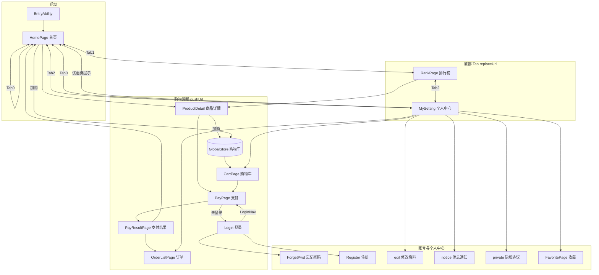
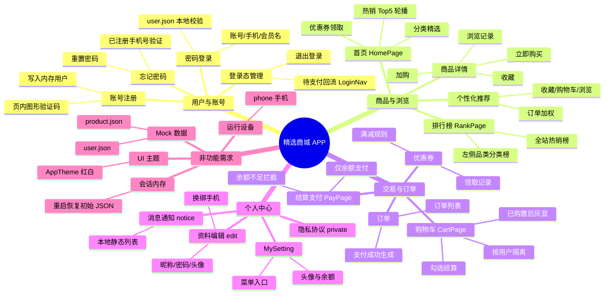
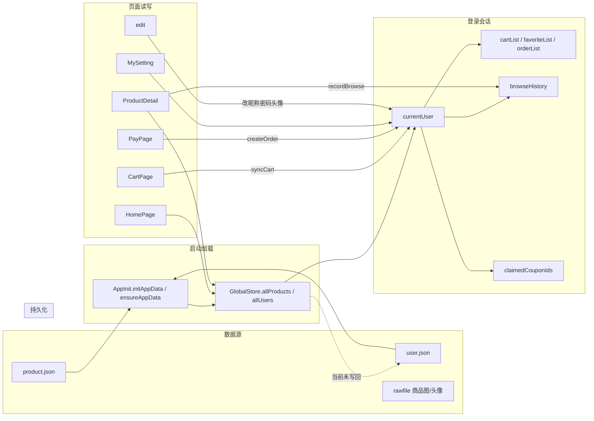
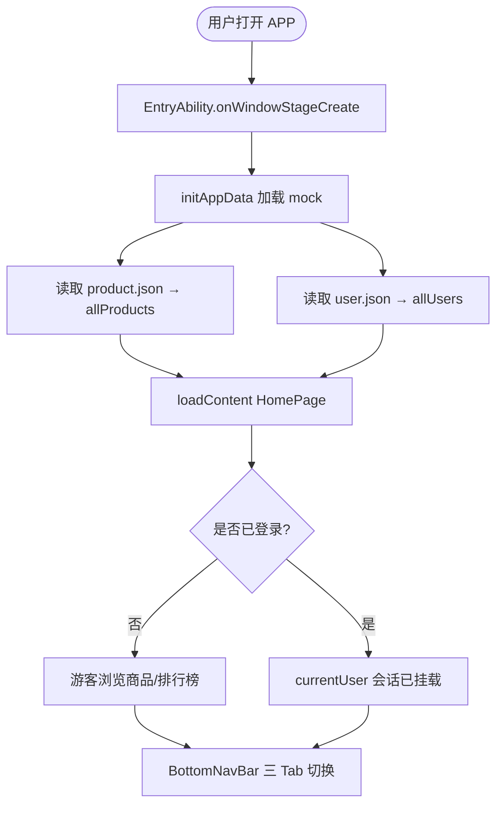
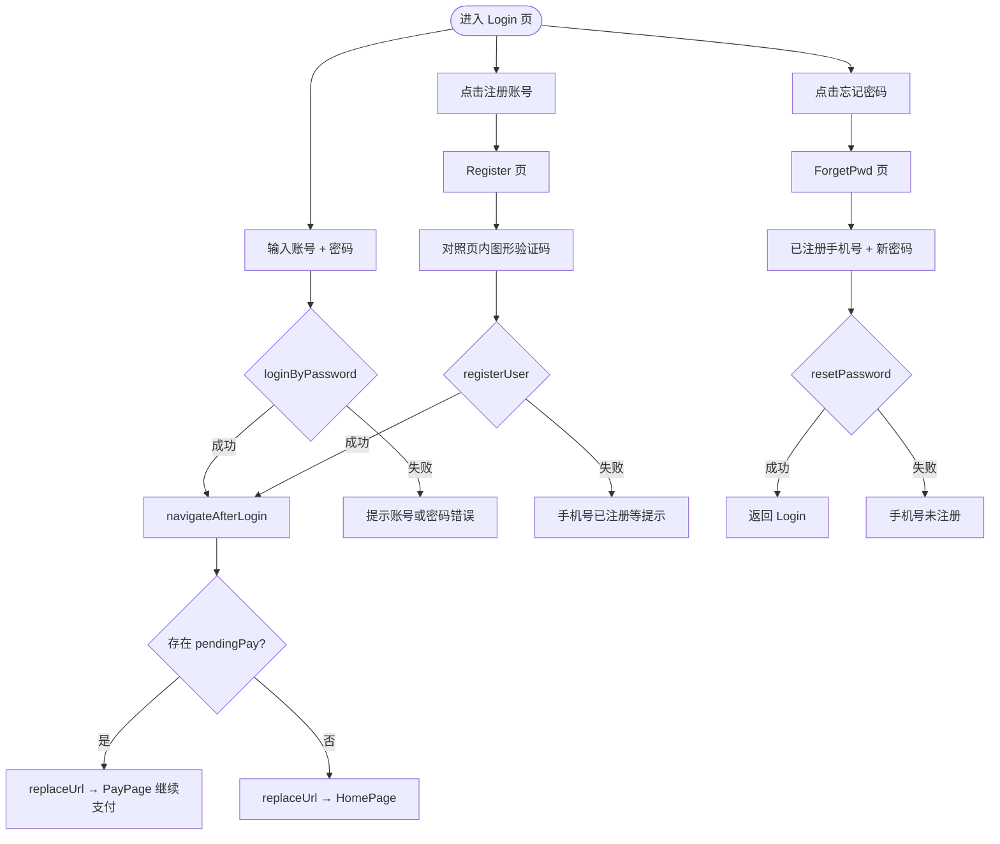
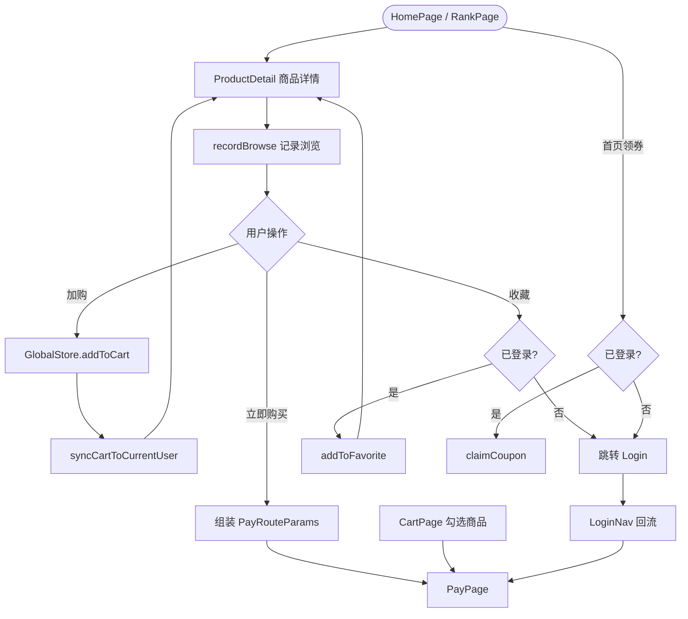
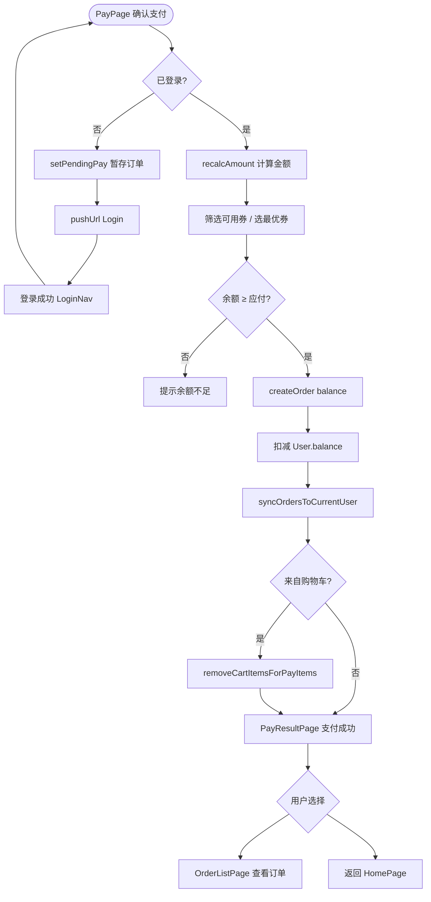
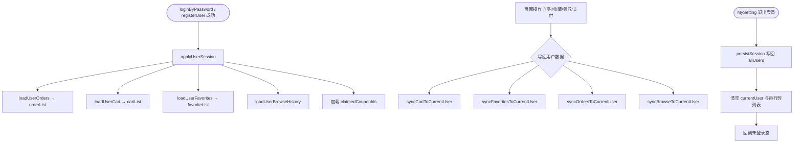
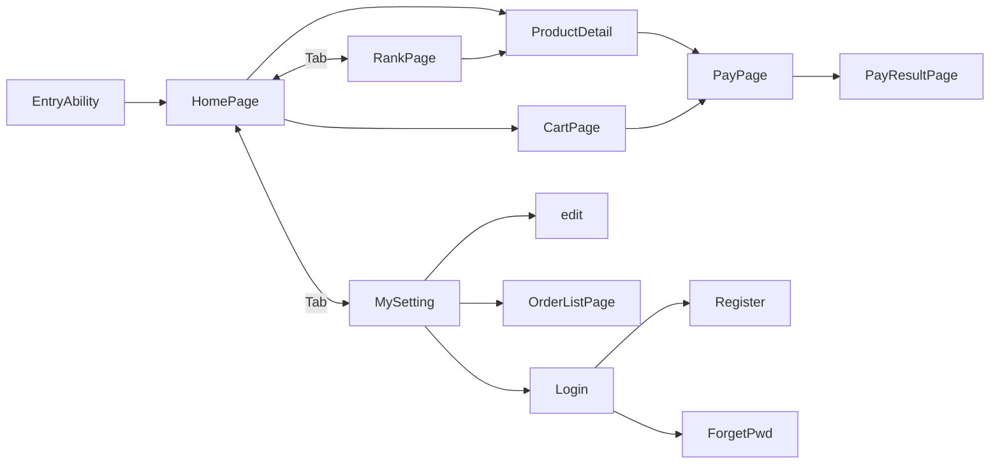

# 精选商城 HarmonyOS 项目文档

> 仓库：`https://gitee.com/bu-su/app.git`  
> 技术栈：HarmonyOS NEXT / ArkTS / ArkUI / 本地 Mock 数据  
> 个人中心页面：**`pages/MySetting`**（`MySetting.ets`）

---

## 一、APP 展示（运行与页面跳转）

### 1.1 启动与入口

| 环节 | 说明 |
|------|------|
| 入口 Ability | `EntryAbility.ets` 在 `onWindowStageCreate` 中调用 `initAppData()` 加载 `product.json`、`user.json`，再 `loadContent('pages/HomePage')` |
| 首屏 | **首页** `HomePage`（非登录页，游客可浏览） |
| 底部导航 | `BottomNavBar`：首页 / 排行榜 / **个人中心（MySetting）** |

### 1.2 页面路由注册（`main_pages.json`）

```
Login, ForgetPwd, Register
HomePage, RankPage, MySetting
ProductDetail, FavoritePage, CartPage
PayPage, PayResultPage, OrderListPage
edit, notice, private
```

### 1.3 主要跳转关系（运行路径）



### 1.4 典型用户操作路径

| 场景 | 路径 |
|------|------|
| 浏览商品 | 首页轮播/推荐 → 商品详情 |
| 领券下单 | 首页领券（需登录）→ 详情「立即购买」或购物车结算 → 支付 → 结果页 |
| 未登录支付 | 支付页 → 登录 → `LoginNav` 自动回到支付页 |
| 看排行 | Tab 排行榜 → 总排行/分类排行（左侧品类）→ 详情 |
| 个人中心 | Tab **MySetting** → 修改资料 / 订单 / 购物车 / 收藏 / 通知 / 隐私 |

### 1.5 路由 API 约定

- **Tab 切换**：`router.replaceUrl`（避免栈过深）
- **进入子页**：`router.pushUrl`（可 `router.back()` 返回）
- **带参跳转**：商品 `RouteParams { product }`；支付 `PayRouteParams { items, fromCart }`

---

## 二、需求分析

### 2.1 需求树状图

从**业务目标**逐层分解需求：实线为当前已实现功能；`~~删除线~~` 为已从代码移除、不切实际的项。

#### 树状结构（Mermaid）



#### 树状结构（文本）

```
精选商城 APP
│
├─ 用户与账号 ─────────────────────────────────────────
│  ├─ 密码登录 ............... Login · loginByPassword
│  ├─ 账号注册 ............... Register · 图形验证码 · registerUser
│  ├─ 忘记密码 ............... ForgetPwd · resetPassword
│  └─ 登录态管理 ............. logout · pendingPay · LoginNav
│
├─ 商品与浏览 ─────────────────────────────────────────
│  ├─ 首页 ................... HomePage · 轮播/领券/分类精选
│  ├─ 个性化推荐 ............. RecommendUtils · 行为加权
│  ├─ 排行榜 ................. RankPage · 全站榜/品类榜
│  └─ 商品详情 ............... ProductDetail · 加购/收藏/购买
│
├─ 交易与订单 ─────────────────────────────────────────
│  ├─ 购物车 ................. CartPage · 多用户隔离/已购置后
│  ├─ 优惠券 ................. GlobalStore.COUPONS · claimCoupon
│  ├─ 结算支付 ............... PayPage · 仅余额 · createOrder
│  └─ 订单 ................... PayResultPage · OrderListPage
│
├─ 个人中心 ───────────────────────────────────────────
│  ├─ MySetting .............. 头像/余额/菜单/退出
│  ├─ edit ................... 昵称/密码/头像/换绑手机
│  ├─ notice ................. 本地静态消息
│  └─ private ................ 隐私协议
│
└─ 非功能需求 ─────────────────────────────────────────
   ├─ Mock 数据 ............... product.json + user.json
   ├─ 会话内存 ............... 运行时 GlobalStore，重启恢复
   ├─ UI 主题 ................. AppTheme #E60012
   └─ 设备 .................... HarmonyOS phone
```

#### 已移除需求（不在实现范围）

```
~~短信验证码登录~~  ~~微信/抖音/Twitter 登录~~  ~~微信/支付宝模拟支付~~
```

**图例**

| 符号 | 含义 |
|------|------|
| 树节点 | 可验收的功能需求 |
| 叶子 `·` 后缀 | 对应页面或核心方法 |
| 删除线项 | 无真实 SDK/后端，已从代码删除 |

### 2.2 功能需求汇总

| 模块 | 功能点 | 优先级 | 实现说明 |
|------|--------|--------|----------|
| 首页 | 热销 Top5 轮播、优惠券领取、分类精选、规则个性化推荐 | P0 | `HomePage` + `RecommendUtils` |
| 排行榜 | 全站热销排序；分类排行 + 左侧品类栏 | P0 | `RankPage` |
| 商品 | 详情展示、加购、收藏（登录）、立即购买 | P0 | `ProductDetail` |
| 购物车 | 按用户隔离；已购商品置后灰显；勾选结算 | P0 | `CartPage` |
| 收藏 | 按用户隔离；猜你喜欢推荐位 | P1 | `FavoritePage` |
| 账号 | 密码登录、注册（图形验证码）、忘记密码 | P0 | 无短信/第三方登录 |
| 支付 | 优惠券满减、**余额支付**、订单生成 | P0 | 已移除微信/支付宝选项 |
| 订单 | 当前用户订单列表 | P0 | `OrderListPage` |
| 个人中心 | **MySetting**：头像/余额/资料、订单/购物车/收藏、消息通知、隐私协议、退出 | P0 | `MySetting.ets` |
| 账户余额 | 余额支付校验与扣款（默认 1000 元 mock，注册赠 200） | P1 | `User.balance` |
| 资料编辑 | 昵称/密码/头像（含自定义头像）；换绑手机（校验占用） | P1 | `edit.ets` |

### 2.3 非功能需求

- 数据：**Mock JSON + 内存态**，重启恢复初始数据（购物车/订单/领券等会话内有效）
- UI：**红白主题** `AppTheme` 统一主色 `#E60012`
- 设备：手机 `phone`

### 2.4 数据流图



### 2.5 核心实体关系

| 实体 | 存储位置 | 说明 |
|------|----------|------|
| `Product` | `product.json` → `allProducts` | 商品全量 |
| `User` | `user.json` → `allUsers` | 含 `cartItems[]`、`favoriteIds[]`、`orders[]` |
| `Order` | 用户 `orders` + 运行时 `orderList` | 支付成功后追加 |
| `Coupon` | `GlobalStore.COUPONS` 常量 | 领取记录在用户 `claimedCouponIds` |

### 2.6 业务流程图

以下流程图按**实际代码逻辑**绘制，菱形为判断分支，矩形为页面或操作。

#### 2.6.1 应用启动流程



#### 2.6.2 登录 / 注册 / 找回密码流程



#### 2.6.3 购物流程（浏览 → 加购 → 结算）



#### 2.6.4 余额支付流程



#### 2.6.5 用户会话与数据同步流程



#### 2.6.6 页面导航总览（简化）



**流程图说明**

| 编号 | 流程 | 关键文件 |
|------|------|----------|
| 2.6.1 | 冷启动加载 mock，首屏 HomePage | `EntryAbility.ets` · `AppInit.ets` |
| 2.6.2 | 密码登录、图形验证码注册、找回密码 | `Login.ets` · `Register.ets` · `LoginNav.ets` |
| 2.6.3 | 详情页加购/收藏/购买，领券需登录 | `ProductDetail.ets` · `HomePage.ets` |
| 2.6.4 | 仅余额支付，未登录中断可回流 | `PayPage.ets` · `Models.createOrder` |
| 2.6.5 | 登录挂载用户数据，退出写回内存 | `Models.applyUserSession` · `logout` |
| 2.6.6 | Tab 与子页 push/replace 关系一览 | `BottomNavBar.ets` · `main_pages.json` |

---

## 三、技术分析（功能实现与代码解析）

### 3.1 工程结构

```
entry/src/main/ets/
├── entryability/EntryAbility.ets    # 启动加载 HomePage + initAppData
├── common/
│   ├── AppInit.ets                  # 读取 mock JSON（仅首次加载）
│   ├── AppTheme.ets                 # 红白主题色常量
│   └── LoginNav.ets                 # 登录后回支付/首页
├── components/BottomNavBar.ets      # 三 Tab，个人中心 → pages/MySetting
├── model/Models.ets                 # 实体、GlobalStore、RecommendUtils
└── pages/                           # 各业务页面
entry/src/mock/
├── product.json
└── user.json
entry/src/main/resources/
├── base/profile/main_pages.json     # 路由表
└── rawfile/                         # 商品图；avatars/ 头像
```

### 3.2 数据初始化与用户会话

**代码位置**：`AppInit.ets`、`GlobalStore.initUsers` / `applyUserSession`

```typescript
// AppInit.ets — 启动时一次性加载
GlobalStore.allProducts = productData.data;
GlobalStore.initUsers(userData.data);

// applyUserSession — 登录后挂载当前用户
GlobalStore.currentUser = copyUser(user);
GlobalStore.loadUserOrders / loadUserCart / loadUserFavorites / loadUserBrowseHistory;
```

**解析**：无后端时，用静态 JSON 作「数据库」；`currentUser` 指针关联内存中的购物车、收藏、订单列表，切换用户前通过 `persistSession*` 写回 `allUsers` 中对应项。

### 3.3 首页：轮播、领券、个性化推荐

| 功能 | 实现 | 文件 |
|------|------|------|
| 热销轮播 | `ProductUtils.getTopHotProducts` 解析 `hot` 字段（支持「万」） | `HomePage.ets` |
| 分类精选 | 每类目取热度最高一件 `getCategoryTopProducts` | `Models.ets` |
| 领券 | `GlobalStore.claimCoupon` + 登录校验 | `HomePage.ets` |
| 为你推荐 | `RecommendUtils` 按订单/收藏/购物车/浏览加权类目打分 | `Models.ets` → `HomePage.refreshPersonalRecommends` |

**推荐规则（节选）**：

```typescript
// 类目权重：订单 +5、收藏 +3、购物车 +2、浏览 +1
// 商品得分：偏好类目加分 + 已收藏/在购加分 + 热度兜底；已购排除
RecommendUtils.getPersonalizedRecommend(allProducts, user, browseIds, purchasedIds, count);
```

**解析**：冷启动（未登录或无行为）回退为全站热销；登录后 `onPageShow` 刷新推荐列表。

### 3.4 排行榜：总榜与分类榜

**代码位置**：`RankPage.ets`、`ProductUtils.sortByHotDesc` / `getProductsByCategory`

- `rankMode === 0`：全商品按热度排序列表  
- `rankMode === 1`：**左侧纵向品类** + 右侧该分类商品排行  

**解析**：分类模式用 `Row` 固定宽度侧栏 + `List` 主列表，选中项左侧红色竖条高亮（`AppTheme.PRIMARY`）。

### 3.5 购物车：多用户与已购置后

**代码位置**：`CartPage.ets`、`GlobalStore.getSortedCartList` / `isProductPurchased`

- 加购：`GlobalStore.addToCart` → `syncCartToCurrentUser` 写 `cartItems: { productId, count }`  
- 游客购物车：登录时 `mergeCartItemsIntoList` 合并  
- 已购商品：`getSortedCartList` 将 `isProductPurchased` 的条目排到末尾并灰显  

### 3.6 登录注册与支付回流

| 功能 | 关键方法 | 说明 |
|------|----------|------|
| 密码登录 | `loginByPassword` | 账号/手机/会员名 + 密码匹配 |
| 注册 | `registerUser` | 图形验证码通过后写入 `allUsers`，自动登录 |
| 忘记密码 | `resetPassword` | 校验已注册手机号后重置密码 |
| 换绑手机 | `updateUserPhone` | 校验新号未被占用 |
| 待支付 | `setPendingPay` / `consumePendingPay` | 未登录点支付先记参数 |
| 登录后跳转 | `navigateAfterLogin` | 有 pending 则 `replaceUrl` 到 `PayPage` |

> **已移除**：短信验证码登录（`SmsLogin`）、微信/抖音/Twitter 第三方登录入口。

```typescript
// LoginNav.ets
let pending = GlobalStore.consumePendingPay();
if (pending !== null) {
  router.replaceUrl({ url: 'pages/PayPage', params: pending });
} else {
  router.replaceUrl({ url: 'pages/HomePage' });
}
```

### 3.7 支付与订单

**代码位置**：`PayPage.ets`、`GlobalStore.createOrder`

1. `recalcAmount`：商品小计 → 可用券 → 最优券/手选 → `payAmount`  
2. `createOrder`：校验余额 → 生成 `Order`（`status: paid`，`payMethod: balance`）→ 扣款并 `syncOrdersToCurrentUser`  
3. 购物车来源支付：`removeCartItemsForPayItems`  
4. **仅支持余额支付**；已移除微信/支付宝 UI 与模拟延迟

### 3.8 个人中心 MySetting

**代码位置**：`MySetting.ets`（组件名 `MySetting`，路由 **`pages/MySetting`**）

| 菜单项 | 跳转 |
|--------|------|
| 消息通知 | `pages/notice`（本地静态数据） |
| 修改个人信息 | `pages/edit` |
| 已购商品 | `pages/OrderListPage` |
| 购物车 / 收藏 | `CartPage` / `FavoritePage` |
| 隐私协议 | `pages/private` |
| 退出登录 | `GlobalStore.logout()` |

头像逻辑：支持 `custom_` 前缀的本地文件头像，否则使用默认资源 `user_77926`。

```typescript
// 底部导航统一入口
router.replaceUrl({ url: 'pages/MySetting' });  // BottomNavBar Tab2
```

### 3.9 商品详情与浏览埋点

**代码位置**：`ProductDetail.ets`

- `aboutToAppear`：`GlobalStore.recordBrowse(productId)` 维护最近 20 条浏览记录  
- 加购 / 收藏 / 立即购买：分别调用 `addToCart`、`addToFavorite`（收藏需登录）、跳转 `PayPage`  

### 3.10 主题与资源

- **`AppTheme.ets`**：主色、背景、文字、边框常量，页面引用避免硬编码散落  
- **商品图**：`$rawfile('1.png')` 等，位于 `resources/rawfile/`  
- **头像**：`GlobalStore.getAvatarRawPath()` → `avatars/xxx.png`  

---

## 四、项目感悟（技术栈与收获）

### 4.1 HarmonyOS / ArkTS 开发体会

1. **声明式 UI（ArkUI）**  
   状态驱动界面（`@State`、`@Prop`）与 `@Builder` 复用列表行，使首页、个人中心列表等结构清晰；需注意 `onPageShow` 中刷新登录态与推荐数据。

2. **路由与页面配置**  
   所有页面必须在 `main_pages.json` 注册；**路径与文件名一致**（个人中心为 `pages/MySetting` 对应 `MySetting.ets`）。Tab 用 `replaceUrl`，子页用 `pushUrl`，避免返回栈混乱。

3. **单例式 GlobalStore**  
   课程/演示项目在无后端时，用静态类集中管理用户、购物车、订单，降低页面间传参复杂度；缺点是需手动 `sync*ToCurrentUser`，扩展持久化时要统一收口。

### 4.2 业务实现收获

| 主题 | 收获 |
|------|------|
| Mock 驱动 | `product.json` / `user.json` 快速迭代演示数据，与 `AppInit` 解耦 |
| 多用户隔离 | 购物车、收藏仅存 id，展示时从 `allProducts` 还原；登录切换加载对应用户 |
| 规则推荐 | 不依赖机器学习也可用加权规则完成「猜你喜欢」，便于答辩讲解 |
| 支付流程 | `pendingPay` + `LoginNav` 解决中断式登录，贴近真实电商体验 |
| UI 规范 | `AppTheme` 统一红白视觉，减少后期改色成本 |

### 4.3 可改进方向

- 将 `user.json` 变更**持久化**（Preferences 或小型数据库）  
- 消息通知对接真实推送或订单状态变更触发  
- 优惠券页独立化，替代 Toast 跳转首页  
- `notice.ets` / `private.ets` / `edit.ets` 硬编码色统一为 `AppTheme`  
- 单元测试覆盖 `ProductUtils.parseHotValue`、`RecommendUtils` 打分逻辑  
- 远程 API 替换 Mock，保留 `GlobalStore` 接口层便于迁移  

### 4.4 协作与工程习惯

- 远程仓库 Gitee 协作时注意 **pull 前 stash 本地修改**，避免未跟踪文件（如 `AppTheme.ets`）阻塞合并  
- 个人中心统一为 **MySetting**，勿再保留已删除的 `ProfilePage.ets` 路由，防止编译或跳转失败  

---

## 附录 A：各功能关键代码索引

> 路径均相对于 `entry/src/main/ets/`；行号为当前仓库版本，改代码后可能略有偏移。  
> 数据层统一入口：`model/Models.ets`（`GlobalStore` / `ProductUtils` / `RecommendUtils`）。

### A.1 基础设施

| 功能 | 关键文件 | 关键代码行 / 方法 |
|------|----------|-------------------|
| 应用启动、加载首页 | `entryability/EntryAbility.ets` | L25 `initAppData()`；L27 `loadContent('pages/HomePage')` |
| Mock 数据加载 | `common/AppInit.ets` | L6–12 `initAppData`；L16–19 `ensureAppData` |
| 页面路由注册 | `resources/base/profile/main_pages.json` | 全部 `src` 列表 |
| Mock 商品/用户数据 | `mock/product.json`、`mock/user.json` | — |
| 主题色常量 | `common/AppTheme.ets` | 全文 `AppTheme.PRIMARY` 等 |
| 底部三 Tab | `components/BottomNavBar.ets` | L18–49 `replaceUrl` → Home / Rank / MySetting |
| 登录后跳转（含待支付回流） | `common/LoginNav.ets` | L5–11 `navigateAfterLogin` |

### A.2 用户与账号

| 功能 | 关键文件 | 关键代码行 / 方法 |
|------|----------|-------------------|
| 密码登录 UI | `pages/Login.ets` | L19–29 `doLogin` |
| 密码登录逻辑 | `model/Models.ets` | L948–958 `loginByPassword` |
| 注册 + 图形验证码 UI | `pages/Register.ets` | L26–32 生成码；L61–68 展示；L75–119 `doRegister` |
| 注册写用户 | `model/Models.ets` | L972–1014 `registerUser` |
| 忘记密码 UI | `pages/ForgetPwd.ets` | L18–44 `resetPwd` |
| 忘记密码逻辑 | `model/Models.ets` | L1016–1026 `resetPassword` |
| 登录挂载会话（购物车/订单/浏览合并） | `model/Models.ets` | L797–823 `applyUserSession`；L818–823 `mergeBrowseIds` |
| 初始化用户列表 | `model/Models.ets` | L758–766 `initUsers` |
| 退出登录 | `pages/MySetting.ets` | L63–66 `doLogout` → `GlobalStore.logout` L960+ |
| 待支付暂存/消费 | `model/Models.ets` | L855–867 `setPendingPay` / `consumePendingPay` |

### A.3 首页与推荐

| 功能 | 关键文件 | 关键代码行 / 方法 |
|------|----------|-------------------|
| 首页入口与数据刷新 | `pages/HomePage.ets` | L19–30 `aboutToAppear` / `onPageShow` |
| 热销 Top5 轮播 | `pages/HomePage.ets` | L22 `getTopHotProducts` |
| 分类精选（每类一件） | `pages/HomePage.ets` | L23；`Models.ets` L95–127 `getCategoryTopProducts` |
| 热度排序/解析 | `model/Models.ets` | L49–64 `sortByHotDesc` / `getTopHotProducts` |
| 领券 UI | `pages/HomePage.ets` | L51–64 `claimCoupon` |
| 领券逻辑 | `model/Models.ets` | L452–458 `COUPONS`；L469–476 `claimCoupon` |
| 个性化推荐 UI | `pages/HomePage.ets` | L33–36 `refreshPersonalRecommends` |
| 推荐门面 | `model/Models.ets` | L652–660 `getPersonalizedRecommend` |
| 推荐算法核心 | `model/Models.ets` | L233+ `buildCategoryWeights`；L321–374 `RecommendUtils.getPersonalizedRecommend` |
| 跳转商品详情 | `pages/HomePage.ets` | L42–44 `goProductDetail` |
| 首页加购 | `pages/HomePage.ets` | L46–48 → `GlobalStore.addToCart` L1132+ |

### A.4 排行榜

| 功能 | 关键文件 | 关键代码行 / 方法 |
|------|----------|-------------------|
| 页面初始化 | `pages/RankPage.ets` | L16–24 `aboutToAppear` |
| 全站榜 / 分类榜切换 | `pages/RankPage.ets` | L26–33 `refreshRankList`；L35+ `switchMode` |
| 按品类筛选 | `model/Models.ets` | L85–93 `getProductsByCategory` |
| 跳转详情 | `pages/RankPage.ets` | L201–203 |

### A.5 商品详情

| 功能 | 关键文件 | 关键代码行 / 方法 |
|------|----------|-------------------|
| 参数校验与浏览埋点 | `pages/ProductDetail.ets` | L16–25 `aboutToAppear`；L21 `recordBrowse` |
| 浏览记录写入 | `model/Models.ets` | L597+ `recordBrowse` |
| 加购 | `pages/ProductDetail.ets` | L114–116 |
| 收藏 | `pages/ProductDetail.ets` | L95–101 → `addToFavorite` L1159+ |
| 立即购买 | `pages/ProductDetail.ets` | L125–132 → `toPayItem` L1211+ |

### A.6 购物车

| 功能 | 关键文件 | 关键代码行 / 方法 |
|------|----------|-------------------|
| 列表刷新与排序 | `pages/CartPage.ets` | L34–68 `refresh` → `getSortedCartList` |
| 已购商品判断/置后 | `model/Models.ets` | L874+ `isProductPurchased`；L889+ `getSortedCartList` |
| 勾选与全选 | `pages/CartPage.ets` | L82–113 |
| 数量增减 | `pages/CartPage.ets` | L317–346 → `updateCartCount` |
| 结算跳转支付 | `pages/CartPage.ets` | L115–129 `goCheckout` |
| 加购/同步购物车 | `model/Models.ets` | L1132+ `addToCart`；`syncCartToCurrentUser` |
| 游客购物车合并 | `model/Models.ets` | L836+ `mergeCartItemsIntoList`（登录时 `applyUserSession` 调用） |

### A.7 收藏

| 功能 | 关键文件 | 关键代码行 / 方法 |
|------|----------|-------------------|
| 收藏列表页 | `pages/FavoritePage.ets` | L24–27 `refresh`；L58–76 列表与删除 |
| 加入收藏 | `model/Models.ets` | L1159+ `addToFavorite` |
| 猜你喜欢加收藏 | `pages/FavoritePage.ets` | L94–103 |

### A.8 支付与订单

| 功能 | 关键文件 | 关键代码行 / 方法 |
|------|----------|-------------------|
| 支付页初始化 | `pages/PayPage.ets` | L21–34 `aboutToAppear` |
| 金额与优惠券计算 | `pages/PayPage.ets` | L43–56 `recalcAmount` |
| 可用券/最优券 | `model/Models.ets` | L1245–1275 `calcCouponDiscount` / `getUsableCoupons` / `getBestCouponId` |
| 余额展示 | `pages/PayPage.ets` | L39–41；`Models.ets` L1076+ `getUserBalance` |
| 确认支付（仅余额） | `pages/PayPage.ets` | L67–102 `doPay` |
| 未登录中断支付 | `pages/PayPage.ets` | L68–75 |
| 创建订单与扣款 | `model/Models.ets` | L1307–1335 `createOrder` |
| 支付后清购物车项 | `model/Models.ets` | `removeCartItemsForPayItems` |
| 支付结果页 | `pages/PayResultPage.ets` | L14–28 读参；L74–82 跳订单/首页 |
| 订单列表 | `pages/OrderListPage.ets` | L21–27 `refreshOrders`；L97–117 订单项展示 |
| 历史订单商品图兼容 | `model/Models.ets` | L138–162 `ProductUtils.resolvePayItemImage`；`OrderListPage.ets` L99 |

### A.9 个人中心与资料

| 功能 | 关键文件 | 关键代码行 / 方法 |
|------|----------|-------------------|
| 个人中心页 | `pages/MySetting.ets` | L30–61 `refreshProfile` / `updateAvatar` |
| 头像路径解析 | `model/Models.ets` | L1104–1120 `getAvatarRawPath`（含 `avatars/img.png`） |
| 菜单跳转 | `pages/MySetting.ets` | L215–233 `ListItemBuilder` |
| 编辑资料页 | `pages/edit.ets` | L27–47 加载；L119–146 `saveProfile` |
| 修改密码 | `pages/edit.ets` | L149–187 `changePassword` |
| 换绑手机 | `pages/edit.ets` | L59–74 → `updateUserPhone` L1028+ |
| 自定义头像选择 | `pages/edit.ets` | L76–112 `selectCustomAvatar` |
| 消息通知（静态） | `pages/notice.ets` | L15–64 数据；L92–120 `markAsRead` / `markAllRead` |
| 隐私协议 | `pages/private.ets` | 全文展示 + `router.back` |

### A.10 快速定位：Models.ets 核心静态方法

| 方法 | 行号（约） | 用途 |
|------|------------|------|
| `ProductUtils.getTopHotProducts` | 63–64 | 热销榜 |
| `ProductUtils.getCategoryTopProducts` | 95–127 | 分类精选 |
| `RecommendUtils.getPersonalizedRecommend` | 321–374 | 推荐打分 |
| `GlobalStore.applyUserSession` | 797–823 | 登录会话 |
| `GlobalStore.loginByPassword` | 948–958 | 密码登录 |
| `GlobalStore.registerUser` | 972–1014 | 注册 |
| `GlobalStore.createOrder` | 1307–1335 | 下单扣余额 |
| `GlobalStore.addToCart` | 1132+ | 加购 |

---

## 附录 B：测试账号（示例）

以 `user.json` 为准，例如：

| 手机号 | 密码 | 说明 |
|--------|------|------|
| 13800138000 | 123456 | 张三，含购物车/收藏/订单样例 |
| 13900139000 | abc123 | 李四 |

注册时使用页面内**图形验证码**（6 位数字对照输入）；忘记密码仅需已注册手机号 + 新密码。

---

*文档版本：与当前 `entry` 模块代码同步；个人中心路由 `pages/MySetting`；已移除短信/第三方登录及模拟第三方支付；附录 A 为功能与代码对照索引。*
