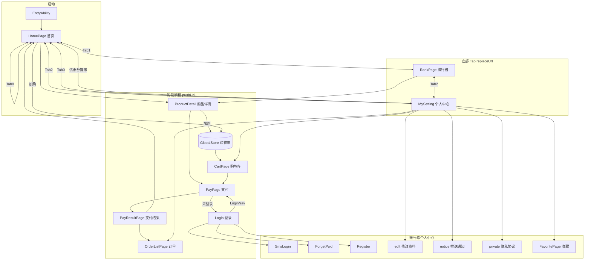
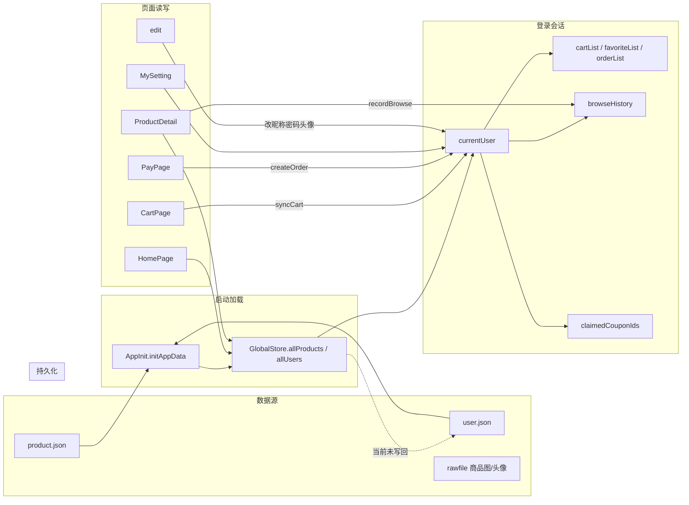

# 精选商城 HarmonyOS 项目文档

> 仓库：`https://gitee.com/bu-su/app.git`  
> 技术栈：HarmonyOS NEXT / ArkTS / ArkUI / 本地 Mock 数据  
> 个人中心页面：**`pages/MySetting`**（`MySetting.ets`）

---

## 一、APP 展示（运行与页面跳转）

### 1.1 启动与入口

| 环节 | 说明 |
|------|------|
| 入口 Ability | `EntryAbility.ets` 在 `onWindowStageCreate` 中调用 `initAppData()` 加载 `product.json`、`user.json`，再 `loadContent('pages/HomePage')` |
| 首屏 | **首页** `HomePage`（非登录页，游客可浏览） |
| 底部导航 | `BottomNavBar`：首页 / 排行榜 / **个人中心（MySetting）** |

### 1.2 页面路由注册（`main_pages.json`）

```
Login, SmsLogin, ForgetPwd, Register
HomePage, RankPage, MySetting
ProductDetail, FavoritePage, CartPage
PayPage, PayResultPage, OrderListPage
edit, notice, private
```

### 1.3 主要跳转关系（运行路径）



### 1.4 典型用户操作路径

| 场景 | 路径 |
|------|------|
| 浏览商品 | 首页轮播/推荐 → 商品详情 |
| 领券下单 | 首页领券（需登录）→ 详情「立即购买」或购物车结算 → 支付 → 结果页 |
| 未登录支付 | 支付页 → 登录 → `LoginNav` 自动回到支付页 |
| 看排行 | Tab 排行榜 → 总排行/分类排行（左侧品类）→ 详情 |
| 个人中心 | Tab **MySetting** → 修改资料 / 订单 / 购物车 / 收藏 / 通知 / 隐私 |

### 1.5 路由 API 约定

- **Tab 切换**：`router.replaceUrl`（避免栈过深）
- **进入子页**：`router.pushUrl`（可 `router.back()` 返回）
- **带参跳转**：商品 `RouteParams { product }`；支付 `PayRouteParams { items, fromCart }`

---

## 二、需求分析

### 2.1 功能需求汇总

| 模块 | 功能点 | 优先级 |
|------|--------|--------|
| 首页 | 热销 Top5 轮播、优惠券领取、分类精选、**规则个性化推荐** | P0 |
| 排行榜 | 全站热销排序；分类排行 + **左侧品类栏** | P0 |
| 商品 | 详情展示、加购、收藏（登录）、立即购买 | P0 |
| 购物车 | 按用户隔离；已购商品置后灰显；勾选结算 | P0 |
| 收藏 | 按用户隔离；猜你喜欢推荐位 | P1 |
| 账号 | 密码登录、短信登录、注册、忘记密码 | P0 |
| 支付 | 优惠券满减、微信/支付宝/余额支付方式、订单生成 | P0 |
| 订单 | 当前用户订单列表 | P0 |
| 个人中心 | **MySetting**：头像/余额/资料、订单/购物车/收藏、推送通知、隐私协议、退出 | P0 |
| 账户余额 | 余额支付校验与扣款（默认 1000 元 mock） | P1 |
| 资料编辑 | 昵称/密码/头像（含自定义头像文件） | P1 |

### 2.2 非功能需求

- 数据：**Mock JSON + 内存态**，重启恢复初始数据（购物车/订单/领券等会话内有效）
- UI：**红白主题** `AppTheme` 统一主色 `#E60012`
- 设备：手机 `phone`

### 2.3 数据流图



### 2.4 核心实体关系

| 实体 | 存储位置 | 说明 |
|------|----------|------|
| `Product` | `product.json` → `allProducts` | 商品全量 |
| `User` | `user.json` → `allUsers` | 含 `cartItems[]`、`favoriteIds[]`、`orders[]` |
| `Order` | 用户 `orders` + 运行时 `orderList` | 支付成功后追加 |
| `Coupon` | `GlobalStore.COUPONS` 常量 | 领取记录在用户 `claimedCouponIds` |

---

## 三、技术分析（功能实现与代码解析）

### 3.1 工程结构

```
entry/src/main/ets/
├── entryability/EntryAbility.ets    # 启动加载 HomePage + initAppData
├── common/
│   ├── AppInit.ets                  # 读取 mock JSON
│   ├── AppTheme.ets                 # 红白主题色常量
│   └── LoginNav.ets                 # 登录后回支付/首页
├── components/BottomNavBar.ets      # 三 Tab，个人中心 → pages/MySetting
├── model/Models.ets                 # 实体、GlobalStore、RecommendUtils
└── pages/                           # 各业务页面
entry/src/mock/
├── product.json
└── user.json
entry/src/main/resources/
├── base/profile/main_pages.json     # 路由表
└── rawfile/                         # 商品图；avatars/ 头像
```

### 3.2 数据初始化与用户会话

**代码位置**：`AppInit.ets`、`GlobalStore.initUsers` / `applyUserSession`

```typescript
// AppInit.ets — 启动时一次性加载
GlobalStore.allProducts = productData.data;
GlobalStore.initUsers(userData.data);

// applyUserSession — 登录后挂载当前用户
GlobalStore.currentUser = copyUser(user);
GlobalStore.loadUserOrders / loadUserCart / loadUserFavorites / loadUserBrowseHistory;
```

**解析**：无后端时，用静态 JSON 作「数据库」；`currentUser` 指针关联内存中的购物车、收藏、订单列表，切换用户前通过 `persistSession*` 写回 `allUsers` 中对应项。

### 3.3 首页：轮播、领券、个性化推荐

| 功能 | 实现 | 文件 |
|------|------|------|
| 热销轮播 | `ProductUtils.getTopHotProducts` 解析 `hot` 字段（支持「万」） | `HomePage.ets` |
| 分类精选 | 每类目取热度最高一件 `getCategoryTopProducts` | `Models.ets` |
| 领券 | `GlobalStore.claimCoupon` + 登录校验 | `HomePage.ets` |
| 为你推荐 | `RecommendUtils` 按订单/收藏/购物车/浏览加权类目打分 | `Models.ets` → `HomePage.refreshPersonalRecommends` |

**推荐规则（节选）**：

```typescript
// 类目权重：订单 +5、收藏 +3、购物车 +2、浏览 +1
// 商品得分：偏好类目加分 + 已收藏/在购加分 + 热度兜底；已购排除
RecommendUtils.getPersonalizedRecommend(allProducts, user, browseIds, purchasedIds, count);
```

**解析**：冷启动（未登录或无行为）回退为全站热销；登录后 `onPageShow` 刷新推荐列表。

### 3.4 排行榜：总榜与分类榜

**代码位置**：`RankPage.ets`、`ProductUtils.sortByHotDesc` / `getProductsByCategory`

- `rankMode === 0`：全商品按热度排序列表  
- `rankMode === 1`：**左侧纵向品类** + 右侧该分类商品排行  

**解析**：分类模式用 `Row` 固定宽度侧栏 + `List` 主列表，选中项左侧红色竖条高亮（`AppTheme.PRIMARY`）。

### 3.5 购物车：多用户与已购置后

**代码位置**：`CartPage.ets`、`GlobalStore.getSortedCartList` / `isProductPurchased`

- 加购：`GlobalStore.addToCart` → `syncCartToCurrentUser` 写 `cartItems: { productId, count }`  
- 游客购物车：登录时 `mergeCartItemsIntoList` 合并  
- 已购商品：`getSortedCartList` 将 `isProductPurchased` 的条目排到末尾并灰显  

### 3.6 登录注册与支付回流

| 功能 | 关键方法 | 说明 |
|------|----------|------|
| 密码登录 | `loginByPassword` | 账号/手机/会员名匹配 |
| 短信登录 | `loginBySms` | 校验 `user.smsCode` |
| 注册 | `registerUser` | 新用户写入 `allUsers` |
| 待支付 | `setPendingPay` / `consumePendingPay` | 未登录点支付先记参数 |
| 登录后跳转 | `navigateAfterLogin` | 有 pending 则 `replaceUrl` 到 `PayPage` |

```typescript
// LoginNav.ets
let pending = GlobalStore.consumePendingPay();
if (pending !== null) {
  router.replaceUrl({ url: 'pages/PayPage', params: pending });
} else {
  router.replaceUrl({ url: 'pages/HomePage' });
}
```

### 3.7 支付与订单

**代码位置**：`PayPage.ets`、`GlobalStore.createOrder`

1. `recalcAmount`：商品小计 → 可用券 → 最优券/手选 → `payAmount`  
2. `createOrder`：生成 `Order`（`status: paid`），写入 `orderList` 并 `syncOrdersToCurrentUser`  
3. 购物车来源支付：`removeCartItemsForPayItems`  
4. 支付方式：`wechat` / `alipay` / `balance`（UI 展示；余额扣减逻辑可按需扩展）

### 3.8 个人中心 MySetting

**代码位置**：`MySetting.ets`（组件名 `MySetting`，路由 **`pages/MySetting`**）

| 菜单项 | 跳转 |
|--------|------|
| 推送通知 | `pages/notice` |
| 修改个人信息 | `pages/edit` |
| 已购商品 | `pages/OrderListPage` |
| 购物车 / 收藏 | `CartPage` / `FavoritePage` |
| 隐私协议 | `pages/private` |
| 退出登录 | `GlobalStore.logout()` |

头像逻辑：支持 `custom_` 前缀的本地文件头像，否则使用默认资源 `user_77926`。

```typescript
// 底部导航统一入口
router.replaceUrl({ url: 'pages/MySetting' });  // BottomNavBar Tab2
```

### 3.9 商品详情与浏览埋点

**代码位置**：`ProductDetail.ets`

- `aboutToAppear`：`GlobalStore.recordBrowse(productId)` 维护最近 20 条浏览记录  
- 加购 / 收藏 / 立即购买：分别调用 `addToCart`、`addToFavorite`（收藏需登录）、跳转 `PayPage`  

### 3.10 主题与资源

- **`AppTheme.ets`**：主色、背景、文字、边框常量，页面引用避免硬编码散落  
- **商品图**：`$rawfile('1.png')` 等，位于 `resources/rawfile/`  
- **头像**：`GlobalStore.getAvatarRawPath()` → `avatars/xxx.png`  

---

## 四、项目感悟（技术栈与收获）

### 4.1 HarmonyOS / ArkTS 开发体会

1. **声明式 UI（ArkUI）**  
   状态驱动界面（`@State`、`@Prop`）与 `@Builder` 复用列表行，使首页、个人中心列表等结构清晰；需注意 `onPageShow` 中刷新登录态与推荐数据。

2. **路由与页面配置**  
   所有页面必须在 `main_pages.json` 注册；**路径与文件名一致**（个人中心为 `pages/MySetting` 对应 `MySetting.ets`）。Tab 用 `replaceUrl`，子页用 `pushUrl`，避免返回栈混乱。

3. **单例式 GlobalStore**  
   课程/演示项目在无后端时，用静态类集中管理用户、购物车、订单，降低页面间传参复杂度；缺点是需手动 `sync*ToCurrentUser`，扩展持久化时要统一收口。

### 4.2 业务实现收获

| 主题 | 收获 |
|------|------|
| Mock 驱动 | `product.json` / `user.json` 快速迭代演示数据，与 `AppInit` 解耦 |
| 多用户隔离 | 购物车、收藏仅存 id，展示时从 `allProducts` 还原；登录切换加载对应用户 |
| 规则推荐 | 不依赖机器学习也可用加权规则完成「猜你喜欢」，便于答辩讲解 |
| 支付流程 | `pendingPay` + `LoginNav` 解决中断式登录，贴近真实电商体验 |
| UI 规范 | `AppTheme` 统一红白视觉，减少后期改色成本 |

### 4.3 可改进方向

- 将 `user.json` 变更**持久化**（Preferences 或小型数据库）  
- 余额支付与 `User.balance` 字段联动校验、扣款  
- 优惠券页独立化，替代 Toast 跳转首页  
- 单元测试覆盖 `ProductUtils.parseHotValue`、`RecommendUtils` 打分逻辑  
- 远程 API 替换 Mock，保留 `GlobalStore` 接口层便于迁移  

### 4.4 协作与工程习惯

- 远程仓库 Gitee 协作时注意 **pull 前 stash 本地修改**，避免未跟踪文件（如 `AppTheme.ets`）阻塞合并  
- 个人中心统一为 **MySetting**，勿再保留已删除的 `ProfilePage.ets` 路由，防止编译或跳转失败  

---

## 附录：测试账号（示例）

以 `user.json` 为准，例如：

| 手机号 | 密码 | 说明 |
|--------|------|------|
| 13800138000 | 123456 | 张三，含购物车/收藏/订单样例 |
| 13900139000 | abc123 | 李四 |

短信验证码与 `user.json` 中 `smsCode` 字段一致（演示用）。

---

*文档版本：与当前 `entry` 模块代码同步；个人中心路由已统一为 `pages/MySetting`。*
